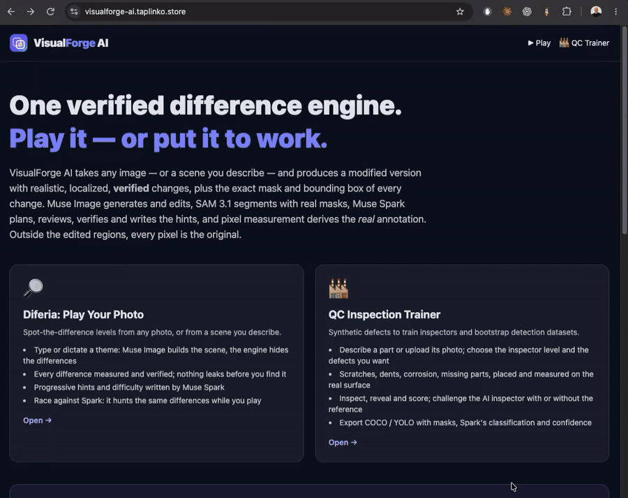

# VisualForge AI — Diferia & QC Inspection Trainer

**Live demo: https://visualforge-ai.taplinko.store** — play the gallery for free; Generating new levels calls Meta’s models on my account, so it sits behind an access code purely as a spending guard (available on request). To generate freely, run it locally with your own key — see Setup.


**One verified visual-difference engine, three experiences.** Given any image, VisualForge produces a modified version with realistic, localized, *verified* changes — plus the exact bounding box and mask of each change.

Built by **Damian Sinay** (indie developer) for the **Meta Global AI Developer Hackathon 2026**, Indie Developer track, theme *"Build for Your World"*. **Deadline: Wed Nov 4, 9:00 PM ET.**

## The three experiences
1. **🔎 Diferia: Play Your Photo** — upload your photo or describe a theme → the engine forges N differences → play in the browser (timer, limited mistakes, hints, score, shareable link; clicks validated server-side, annotations never leak early).
2. **🏭 QC Inspection Trainer** — the same engine generates realistic product defects (scratch, crack, dent, missing component…) to train inspectors and export labeled **COCO JSON / YOLO** datasets. *Synthetic — validate before industrial use.*
3. **🤖 Challenge the AI inspector** — race Muse Spark itself: one Spark call inspects the defective unit (no reference by default, or with the known-good reference) and its findings are validated server-side against the real boxes (finding box expanded 16 px overlapping the real bbox, or either center inside the other; per-finding calibration logged). Beat the AI on coverage, then on time — in QC and, as "Race against Spark", in Play. Each challenge accumulates per-difference Spark *detectability* (migration `0006`), shown in the QC reveal and exported in COCO.

## How Meta models are used
```text
upload or theme → Spark moderation → (Muse Image generates the scene)
→ SAM 3.1 segmentation with real masks ∥ Spark plan → Muse Image one-pass edit of the full image
→ alignment compensated → real edits separated from re-render noise → composed over the ORIGINAL (rest pixel-identical)
→ each change measured (mask, bbox, centroid) → Spark review, dedupe, hints → crop edits + Spark verify top up if short → publish
```
| # | Model | What it does here | Code |
|---|---|---|---|
| 1 | Muse Spark 1.3 | Text moderation of the theme, with a tidied rewrite for voice dictation | `moderateTheme` |
| 2 | Muse Image 1.0 | Scene **generation** from the theme (4:3, `reasoning_strength`) | `museImageGenerateScene` |
| 3 | Muse Spark 1.3 | Image moderation | `moderate` |
| 4 | Muse Spark 1.3 | Lists the segmentable objects, or the *parts* of a product in QC | `segment` |
| 5 | SAM 3.1 | Segments every concept in parallel, streaming, with confidence and **real masks** decoded by the official `@meta-sam/parser` | `samSegmentConcept`, `maskRasterToFrame` |
| 6 | Muse Spark 1.3 | Plans N+3 change candidates with a strict JSON schema, difficulty and a variety quota | `plan` |
| 7 | Muse Image 1.0 | **Edits** the full image in one pass ("make N minimal differences") | `editFullImage` |
| 8 | Muse Spark 1.3 | Reviews each measured change from before/after crops and writes the player-facing description | `reviewDifferences` |
| 9 | Muse Image 1.0 | Edits individual crops when the one-pass delivered fewer than N | `editMaskedRegion` |
| 10 | Muse Spark 1.3 | Verifies each crop edit; classifies QC defects (type, severity, confidence) | `verify`, `classifyDefects` |
| 11 | Muse Spark 1.3 | Writes three progressive hints and a difficulty rating per difference | `generateHints` |
| on demand | Muse Spark 1.3 | Plays as the AI inspector: finds the differences itself, validated against the real boxes | `POST /api/ai-inspect` |

Full detail, prompts, verified endpoints and costs: [AI_INTEGRATION.md](AI_INTEGRATION.md). **The real Meta providers (SAM 3.1 streaming segmentation, Muse Spark structured plan/verify, Muse Image crop-edit + composite) are implemented verbatim from the official docs and were validated end-to-end by the Phase-0 spike on 2026-10-29 (5 paid calls, full loop verified; full-image editing rejected with pixel evidence). They are wired into the app as async generation jobs (`POST /api/generate` → poll → playable level) behind the kill switch and credit limits.** With the offline **MOCK** provider (clearly labeled in the UI and outputs) the app returns the demo level instead — never a silent fake.

## Setup
Requires Node 22 (20.17+). A Meta Model API key from dev.meta.ai. Supabase is optional.
```bash
npm ci && cp .env.example .env.local   # fill Supabase (optional) + Meta (server-only) keys
npm run dev                            # development mode, http://localhost:3000
```
In .env.local set MODEL_API_KEY, META_REAL_CALLS_ENABLED=true, AI_PROVIDER=meta, VF_THEME_GENERATION=true, VF_SAM_MASKS=true. Leave VF_ACCESS_CODE and VF_SPEND_CAP_USD empty locally. 
Without Supabase everything runs in memory (levels are lost on restart, gallery empty). 
With Supabase: create a project, run supabase/migrations/0001 … 0008 in order in the SQL editor, and set the three SUPABASE variables. Try it: /play → type a theme → Generate (1–2 min); /qc → describe a part → Easy, 3 defects → Generate → Reveal → Export. Tests never call the API.

## Configuration (server-side, `.env.local`)
The Play page is intentionally user-facing — none of this appears in the UI. Real Meta generation is opt-in and credit-protected:
- `AI_PROVIDER=meta` + `META_REAL_CALLS_ENABLED=true` + `MODEL_API_KEY`: enables real generation. Without them, `/play` returns a clearly labeled demo level (offline MOCK provider) — never a silent fake "AI" result.
- `VF_THEME_GENERATION=true`: enables theme→scene generation on `/play`. Flow: Muse Spark **text-only moderation first** (a rejected theme never reaches a paid call and fails as `theme_rejected`), then one Muse Image generation (`POST /v1/images/generations`, docs-verified shape: aspect-only `size`, no `moderation` field — that enum is Spark-only; flat $0.01/image, logged per call in `visualforge_ai_calls`), then the standard pipeline. The theme and the model's `revised_prompt` are stored on the level (migration `0003_level_theme.sql`; pre-0003 databases simply persist without them). The theme box (Play) and the describe-a-part box (QC) also support **voice dictation** (Web Speech API where the browser offers it; interim results land in the field live, 10 s of grace to start talking then auto-stop after 3 s of silence; on Safari/iOS — where WebKit has no continuous mode — the recognizer runs non-continuous and auto-restarts after each phrase until you stop or go silent, and mic/recognition errors show in plain language under the field): when dictation stops, that same single Spark moderation call also returns a tidied rewrite of the dictated text (`cleanTheme`, same language, fillers and spoken self-corrections dropped), offered inline as "✨ Spark suggests … [Use this] [Keep mine]". A one-time server-side ticket ([src/lib/server/themeTickets.ts](src/lib/server/themeTickets.ts)) ties the dictation check to the following generation, so moderation still happens **exactly once** per theme — any manual edit invalidates the ticket and the job moderates as before.
- `VF_SCENE_REASONING` (`low|medium|high`, default `high`): reasoning effort for the scene-generation call only.
- `VF_SAM_MASKS=true`: use real SAM masks (official `@meta-sam/parser`) for local recolor/compositing, with per-change fallback to bbox behavior.
- Hints & per-difference difficulty (capability 2, always on with the real provider): the level **publishes the moment its differences are measured**; afterwards, **one** Muse Spark call per level runs **in the background** and writes 3 progressive hints and a difficulty rating (1–5) per difference (migration `0004_difference_hints.sql`; pre-0004 databases persist without them). `POST /api/hint` serves the next hint of the easiest pending difference — until the Spark hints land it serves a positional hint derived from the bbox, marked `provisional` (Play labels it "Quick hint"); the score weights each find by its difficulty. One-pass component selection applies a visibility floor by job difficulty as a **priority, not a gate** (easy: area ≥ 0.25 % of the image and mean amplitude ≥ 40; medium: ≥ 0.12 % / ≥ 35; hard: no priority floor): above-floor components are reviewed first, below-floor ones are **held as the last resort** — tried only after the crop path and its replacement plan are exhausted — and an absolute floor rejects specks outright even when the count stays short (easy/medium: area < 0.08 % or amp < 30; hard: 0.04 % / 25).
- Count guarantee (game mode): a level **never ships short**. Order of remedies: one-pass → crop candidates → **replacement plan** (one extra Spark call for the missing count + 2, planned over only the regions that don't overlap an accepted difference) → one completion full-image Muse call asking only for the missing differences → held below-floor one-pass components as the last resort. Still short, the job fails with a clear message ("We could only create X of the N differences…") instead of delivering a short level.
- QC mode (defect counts 1–5): SAM's concept listing asks for **parts/features** of the part, the planner anchors every defect with its own pixel `targetBox` + part name inside a region (several defects may share one region — e.g. the whole part), and overlap is judged only against accepted defects' **measured** boxes (8 px margin), never the region box. The /qc **difficulty selector is the inspector level** (Easy/Medium/Hard, default Medium, sent as `difficulty` in `POST /api/generate` like /play): easy/medium prefer a minimum **measured** defect area — 0.10 % / 0.05 % of the image — as a **priority, not a gate**, applied in the one-pass component selection and in the crop executor before the Spark verify call: below-floor defects are **held** while the next candidate is tried, and once candidates are exhausted the best held defects deliver as the last resort instead of failing the level; three consecutive below-floor candidates relax the floor one tier for the rest of the job (logged) so paid calls aren't burned chasing it; hard has no floor. For easy/medium the QC planner prompt also demands defects clearly visible at normal viewing size, on the largest surfaces of the part, and easy asks the planner and the edit prompts for "a large, clearly visible defect covering a significant part of the surface, not a small mark". The difficulty is stored on the level (migration `0007_level_difficulty.sql`; pre-0007 databases persist without it), shown in the gallery and as "Inspector level: Easy" in the reveal. /qc also has an optional **"What defects should appear?"** free-text field (`defectHint` in `POST /api/generate`, QC only, max 300 characters; empty/absent changes nothing): the job moderates it with the same text moderation as themes, then the planner gets it verbatim — "The inspector asked for these defects, in priority order: … Plan them first, mapped to the closest allowed defect types…" — and the one-pass and crop edit prompts carry the same request, while defect descriptions and the Spark classification still come from what was measured, never from the hint. It is stored on the level (migration `0008_level_defect_hint.sql`; pre-0008 databases persist without it) and shown in the gallery and in the reveal as "Requested: …". Because the hint rides inside every Muse Image edit prompt, wording the image safety filter rejects ("burnt" — field case on Render, 2026-11-03) used to fail **every** edit of the job; now the prompt copy of the hint is softened first (burnt/burned → "overheated", scorched/blood → "discolored", fire → "heat", smoke → "discoloration", exploded/destroyed → "damaged"; each replacement logged, the stored "Requested:" text unchanged), and a `content_policy_violation` from `/images/edits` is its own case: an edit whose prompt carried the hint is retried **once** without the hint sentence — success disables the hint for the rest of the job and marks the level "defect request could not be applied by the image model" — while a second violation, or one on a hint-less prompt, aborts the job immediately with "The image safety filter rejected your defect description. Use plainer wording, e.g. 'discolored solder joint' instead of 'burnt'." instead of burning every candidate. One-pass paints defects on the full image first, crops top up, and a short QC level **publishes partial** with a "Generated N of M defects" notice instead of failing. After measurement, **one** Muse Spark call classifies every defect from before/after crops (type within the 8 QC categories, severity 1–5, confidence 0–1, short label; migration `0005_difference_classification.sql`, pre-0005 databases persist without it): exports label with the **classified** type and ship confidence < 0.6 separately as `needs_review` (`/api/qc-export?part=review`). The trainer runs on the real level — server-validated clicks, timer, "Reveal & score" (`GET /api/qc-reveal`, QC levels only) — and saves the session (`visualforge_qc_sessions`, table since migration 0001; in-memory without Supabase). A missing DB column is logged once per process, and a transient network failure inside a Meta call is retried exactly once (2 s) within the per-change budget.
- Challenge the AI inspector (`POST /api/ai-inspect`, one Spark call per challenge, so it sits behind the same single access rule as generation — see "Running the public demo safely" — plus 10 challenges/hour/IP): **one** Muse Spark call per challenge inspects the defective/modified image — `no-reference` (default, target only) or `with-reference` (known-good first) — and returns normalized finding boxes that the **server** validates (finding box expanded 16 px overlapping an unclaimed real bbox, or the center of either box inside the other; each difference claimable once, duplicates count as false positives; every finding is logged against its nearest real box with the center distance, for calibration). The annotations never leave the server. Response: matched findings (with the real classified type / game description), false positives, missed, and the measured Spark latency. Every challenge accumulates per-difference **detectability** (attempts, hits, modes found in; migration `0006_difference_detectability.sql`, best-effort DB mirror), shown in the QC reveal and exported as a COCO annotation attribute. UI: "Challenge the AI inspector" in `/qc` (restarts the human clock, Spark races in parallel, fuchsia boxes, compared verdict) and "Race against Spark" in `/play` — in Play Spark always sees both images (spotting differences is a comparison; the "AI sees" choice exists only in the QC trainer, where inspecting the unit alone is the realistic mode).
- Credit guards: `MAX_CHANGES_PER_JOB`, `MAX_JOBS_PER_DAY`, `ESTIMATED_COST_PER_LEVEL_USD` (see [src/lib/limits.ts](src/lib/limits.ts)).
- Public-demo protection, all checked before any provider work — see **"Running the public demo safely"** below for the full model. In short: **one access rule** — when `VF_ACCESS_CODE` is set, every route that calls Meta's models requires the access code through the single `requireMetaAccess` helper ([src/lib/server/access.ts](src/lib/server/access.ts)): `POST /api/generate` (level + theme scene generation, dictation theme moderation) and `POST /api/ai-inspect` ("Race against Spark" / "Challenge the AI inspector"); without it they answer 401 with "This action uses Meta's models and needs the access code. The gallery is free to play." (constant-time comparison). `/play` and `/qc` show a "access code" field and remember it in `localStorage` — the race/challenge buttons send the same remembered code. A test walks every route in `src/app/api` and fails if a Meta-calling route ever skips the helper. Second layer: `VF_SPEND_CAP_USD` / `VF_SPEND_CAP_SINCE`, a hard global budget summed from `estimated_cost_usd` in `visualforge_ai_calls` — at the cap the Meta routes answer 429 ("Budget for the judging period is exhausted; the gallery remains playable") and every job logs its own estimated spend, the accumulated total and the remaining budget. Costs are the **real published prices** ([src/lib/engine/pricing.ts](src/lib/engine/pricing.ts), verified on dev.meta.ai): Spark $1.25/1M input + $4.25/1M output tokens (from each response's usage), SAM $0.0025/image, Muse Image $0.01 per generated image — generations only: the pricing page lists **no Muse Image token price** (re-verified 2026-11-02), so every edit is costed with a conservative constant `MUSE_IMAGE_EDIT_USD_FALLBACK = 0.50`, and the budget sum reprices edit rows logged earlier at $0.01 to that fallback. Each job also logs its input/output token totals per model. Plus, active in the same public-demo mode, a per-IP limit of 5 generations/hour (in-memory sliding window, 429), and the always-on daily cap counted from today's `visualforge_generation_jobs` rows (in-memory count as fallback without Supabase). Routes that never call Meta — the gallery, `/api/level`, `/api/validate-click`, `/api/hint` (stored hints), exports — stay free for everyone.
- Level gallery: the landing and `/play` list the 12 most recent published levels from Supabase (`GET /api/gallery`, original-image thumbnails); playing one loads its stored images via `GET /api/level` — it generates nothing (this also makes Play share links work).
- Public host: the demo lives at **https://visualforge-ai.taplinko.store**. With `VF_PUBLIC_HOST` set (see [.env.example](.env.example)), the Next middleware answers any request that still arrives under the legacy `visualforge-ai.onrender.com` host with a **301** to the same path on the new host; unset (local dev) means no redirects.
- Supabase persistence is best-effort and additive: jobs/levels/differences/images/ai-calls are mirrored to `visualforge_*` tables when `NEXT_PUBLIC_SUPABASE_URL` + `SUPABASE_SERVICE_ROLE_KEY` are set; the game also works fully in-memory without them.

## Running the public demo safely
The live demo is public, and after the hackathon credits expire every Meta call bills the owner's card. Two independent layers keep that bounded — both are checked **before any paid call**, and generation speed is untouched (segmentation and planning still run in parallel with the one-pass edit, exactly as before):

1. **One access rule (`VF_ACCESS_CODE`).** When the variable is set, *every* route that calls Meta's models requires the access code, through the single `requireMetaAccess` helper ([src/lib/server/access.ts](src/lib/server/access.ts)): level and theme-scene generation, the dictation theme moderation with its Spark tidy-up, "Race against Spark" and "Challenge the AI inspector" — and any future Meta route: a test walks all of `src/app/api` and fails if a route that touches the providers doesn't use the helper. Without a valid code those routes answer `401` — *"This action uses Meta's models and needs the access code. The gallery is free to play."* Routes that never call Meta stay open to everyone: the gallery, loading a stored level, server-validated clicks, already-saved hints and the COCO/YOLO exports. Unset the variable and everything is open (local development).
2. **A hard global budget (`VF_SPEND_CAP_USD` + `VF_SPEND_CAP_SINCE`).** Before any paid call, the estimated spend recorded in `visualforge_ai_calls` since `VF_SPEND_CAP_SINCE` is summed; at or over the cap the Meta routes answer `429` — *"Budget for the judging period is exhausted; the gallery remains playable"* — and the gallery keeps working. Every cost is a **real published price** ([src/lib/engine/pricing.ts](src/lib/engine/pricing.ts), verified 2026-10-31 on [dev.meta.ai/docs/pricing-rate-limits](https://dev.meta.ai/docs/pricing-rate-limits)): Muse Spark $1.25 per 1M input tokens and $4.25 per 1M output tokens (cached input $0.15), computed from each response's reported usage; SAM 3.1 $2.50 per 1,000 images ($0.0025 per call); Muse Image a flat $0.01 per **generated** image — the page lists no Muse Image token price (re-verified 2026-11-02), so edits, are costed with a conservative constant `MUSE_IMAGE_EDIT_USD_FALLBACK = 0.50` (calibrated against the dashboard, and historical edit rows logged at $0.01 are repriced to it when the budget is summed). Every generation job logs its own estimated spend, the accumulated total and the remaining budget, plus its input/output token totals per model, so the burn is visible in the server log long before the cap bites. The pre-existing limits stay as they were: 5 generations/hour/IP while the code is set, 10 AI challenges/hour/IP, and the daily job cap counted from the database.

Suggested judging-period settings: `VF_ACCESS_CODE=<the code from the submission>`, `VF_SPEND_CAP_USD=25`, `VF_SPEND_CAP_SINCE=2026-11-04`. All tests run against fake providers only — no test ever calls the real API.

## Tests
```bash
npm test            # Vitest: pipeline, composite invariant, mask→bbox, click tolerance, scoring, race, COCO/YOLO, provider, limits
.venv/bin/python -m pytest tests/test_composite.py   # Python env lives in .venv (git-ignored)
npm run test:e2e    # Playwright: single-player flow on MOCK
```
**Status (2026-11-03):** Vitest 154/154 (incl. the async generation loop with fake providers, the one-pass path, the moon-flag dedupe suite — 10 px strong-core grouping dilation so thin connectors join their parts, Spark `sameChangeAs` semantic dedupe, location-stripped description dedupe, and the 6 %-of-smaller-side minimum-separation fusion across one-pass and crop paths — the QC inspector-level suite — difficulty selector semantics with the measured-area floor as priority, not gate (easy 0.10 % / medium 0.05 %, hard none): below-floor defects held and delivered as the last resort in both the crop executor and the one-pass selection, the floor relaxing one tier after three consecutive below-floor candidates, easy asking for large defects in the planner and edit prompts, the QC planner's largest-surfaces prompt rule captured through a fake fetch, and the difficulty stored on the level and exposed by the QC reveal — the QC defect-hint suite: the inspector sentence verbatim in the plan prompt (captured through a fake fetch), byte-identical prompts without a hint, theme moderation gating the hint before any planning spend, plan order respected, the hint stored on the level and returned by the reveal, and the 300-character route validation — the defect-hint image-policy suite: hint wording softened before any prompt (the level still stores the original), a simulated `content_policy_violation` 400 retried once without the hint in both the one-pass and crop paths with the hint disabled afterwards and the level marked, and an immediate job abort with the plain-language message — with zero candidates consumed — when the retry or a hint-less prompt is rejected — duplicate-difference dedupe, the visibility floor as priority with below-floor components held as last resort under an absolute floor, Spark hints + difficulty written in the background after publication, the count-completion guarantee — replacement plan over free regions, then a completion one-pass call, otherwise the job fails loudly — theme generation with voice dictation (Spark `cleanTheme` tidy-up in the same moderation call, one-time pre-check tickets so moderation runs exactly once), iOS/Safari dictation (10 s start grace before the silence cut, non-continuous auto-restart on WebKit, plain-language mic error messages), the VF_ACCESS_CODE 401/429/pass-through guards on /api/generate, the credit-saving suite — real Meta prices (Spark per-token from response usage, SAM per image, Muse Image per generated image; edits at the dashboard-calibrated $0.50 fallback since the pricing page lists no Muse Image token price, with historical $0.01 edit rows repriced in the cap total and per-model token totals logged per job), the single `requireMetaAccess` + spend-cap gates on both Meta routes with 401-before-429 ordering, and a walk over every route in `src/app/api` that fails any Meta-calling route missing the gates — the QC completion suite — multiple defects on one whole-part region, Spark defect classification with needs_review export split, QC-only reveal, saved trainer sessions, one-retry network resilience — the AI-inspector suite (finding validation under the 16 px box-overlap rule with calibration data, coverage-then-speed verdict, detectability accumulation, 10/hour/IP challenge limit) and sharp composite/measurement invariants) and Playwright 1/1 verified 2026-10-30; pytest 2/2 last verified 2026-10-29. The one-pass extraction calibration (`tests/onepass-calibration.test.ts`) synthesizes its 3 edits + simulated Muse re-render (3 px drift, softening, re-encode) over `test.jpeg` — the beach photo the game itself generated — after the previous fixture (a saved edit of a third-party flower photo) stopped matching the replaced photo.

## Feature status
| Feature | Status |
|---|---|
| Engine pipeline + providers + credit limits | ✅ real Meta spike-validated + wired as async jobs |
| Play Your Photo (upload or theme → generate → server-validated play, click either image) | ✅ playable · theme→scene ✅ (VF_THEME_GENERATION) · hints + difficulty ✅ (capability 2) |
| Challenge the AI inspector (Spark race in QC + Play, detectability) | ✅ one Spark call per challenge, server-validated findings, 10/hour/IP, judge-code gated like every Meta route |
| QC Trainer + COCO/YOLO export | ✅ real-level trainer (server-validated clicks, timer, reveal & score, saved sessions) · multi-defect per part via per-defect targetBox · Spark defect classification (type/severity/confidence, migration 0005) with needs_review export split · partial levels ship with a "Generated N of M defects" notice · inspector-level difficulty (Easy/Medium/Hard: measured-area floor as priority with held last resort + largest-surfaces planner rule, stored on the level — migration 0007 — and shown in the gallery and reveal) |
| Public-demo protection (one access rule on all Meta routes, VF_SPEND_CAP_USD budget at real prices, 5/hour/IP, DB daily cap) + level gallery | ✅ |
| Landing "one engine, three uses" | ✅ |

## Roadmap
- Real-time multiplayer (rooms, presence, first-finder-claims on the DB unique constraint): schema and race guard are in place, UI and Supabase Realtime wiring planned for the next version. Not part of this submission.

## Built during the hackathon
Everything in this repository: Next.js app, engine, providers, Supabase schema, Python worker, tests, docs — written from scratch during the event. No pre-existing code imported, no third-party images (scenes are procedural/MOCK or Muse Image-generated).
The Play gallery includes one personal photograph of me, the project creator. I am the person depicted, I own the rights to the photo, and I use it here by my own choice. It is included on purpose: to demonstrate that VisualForge AI can generate visual differences while preserving human faces, body proportions and overall appearance. The engine never edits faces or bodies, and pixels outside the edited regions are copied unchanged from the original.

## Built with Muse
This project was built with Meta’s Muse Code as the development partner.

## Known limitations
Real Meta generation runs only when deliberately enabled server-side (`AI_PROVIDER=meta` + kill switch on, per-flag opt-ins — see Configuration); jobs/levels live in server memory with best-effort Supabase mirroring.

MIT License — see [LICENSE](LICENSE).
